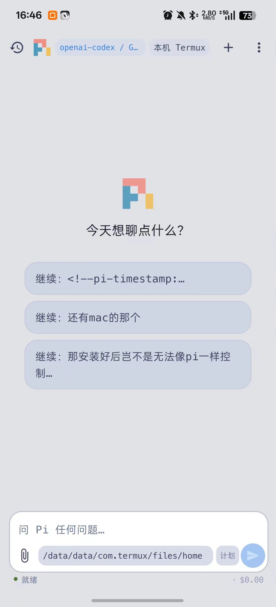

# pi-android

**A native Android client for Pi, with local Termux and remote Tailscale connections.**

English | [简体中文](README.zh-CN.md)

pi-android connects a Java-based Android app to [Pi](https://github.com/earendil-works/pi) through a Node.js WebSocket bridge and Pi's documented `pi --mode rpc` interface. Pi runs in your existing Termux or computer environment; the app does not bundle a second Pi runtime.

**Unofficial community project. Not affiliated with or endorsed by Earendil Inc.** No Pi source code is vendored or patched. See [Notices and attribution](NOTICE.md) for third-party branding, UI references, and licensing information.

## Screenshot

<p align="center">
  
</p>

Light-theme home screen with the local Termux profile selected. The screenshot shows the Chinese interface.

## Project scope

Choose between two connection modes:

- **Local:** run the Android app, bridge, and Pi on the same device using Termux and `127.0.0.1:8945`.
- **Remote:** run the bridge and Pi on a computer, join the phone and computer to the same Tailscale network, and select that computer's connection profile in the app.

The bridge uses the Pi configuration available on its host, normally under `~/.pi/agent`, including model credentials, skills, extensions, and stored sessions. Remote execution remains on the computer. Tailscale is installed separately; the app does not embed a VPN, provide a hosted relay, or make the bridge safe to expose to the public internet.

## Features

- Streaming conversations with Markdown, code blocks, tool timelines, model thinking, response cancellation, and steer/follow-up input during generation.
- Session creation, history browsing, switching, forking, renaming, deletion, and local pinning; input history and conversation search/export.
- Model and thinking-level selection, subject to the installed Pi version and provider capabilities.
- Image and file attachments, project-file references, file/Git views, and direct shell interactions.
- Tables, inline images, and SVG/HTML reply previews. HTML/SVG previews use a restricted WebView with JavaScript and network access disabled.
- Extension interactions: select, confirm, input, editor, notifications, status updates, titles, and text widgets.
- Per-session instructions, scheduled messages, and command-based completion checks through `/until`.
- Multiple connection profiles with status/latency checks and per-profile model/session state; local Termux connector startup and updates from Settings.
- Foreground connection service, background interaction notifications, and text sharing through Android `ACTION_SEND` with `text/plain`.
- History-derived empty-state suggestions, with fallback behavior for older connectors.
- A compact native interface with Meslo Nerd Font typography and light/dark themes.

The UI covers a subset of Pi's RPC capabilities. Availability depends on the installed Pi and connector versions; this repository does not publish a version-by-version compatibility matrix.

## Architecture

```text
Android app (dev.pi.android)
    │ WebSocket + shared token
    ├── Local: 127.0.0.1:8945 → Termux bridge
    └── Remote: Tailscale address:8945 → computer bridge
                                             │
                                  JSONL over stdin/stdout
                                             ▼
                                   Pi: pi --mode rpc
                                             │
                              Host configuration and tools
```

Each bridge starts one Pi child process on demand and shares it between connected clients. Sessions persist by default; `--no-session` explicitly requests a temporary session. Closing the app UI does not necessarily stop its foreground service or the bridge. After the last WebSocket client disconnects, the bridge stops its Pi child after 600 seconds by default; `--idle-exit 0` disables this timeout. Android may still terminate apps under background-execution or battery-management policies.

## Local setup with Termux

### Requirements

- Android 8.0 / API 26 or later, as declared by the build configuration. This is not a device-compatibility guarantee.
- Termux with Node.js, npm, and a working Pi installation supporting `pi --mode rpc`.
- A model provider configured in that Termux Pi environment.
- A checkout of this repository in Termux and an installed pi-android APK.

### 1. Prepare the bridge and token

Run from the repository root in Termux:

```sh
npm ci --prefix bridge
pi --version
```

Create a shared token. This command creates the parent directory and refuses to overwrite an existing token:

```sh
node --input-type=module -e '
import fs from "node:fs";
import os from "node:os";
import path from "node:path";
import { randomBytes } from "node:crypto";
const dir = path.join(os.homedir(), ".pi/agent");
fs.mkdirSync(dir, { recursive: true });
fs.writeFileSync(path.join(dir, "pi-android.token"), randomBytes(24).toString("base64") + "\n", { mode: 0o600, flag: "wx" });
'
```

If it reports `EEXIST`, reuse the existing token; do not replace it without updating the app's profile. Keep its contents private. The bridge refuses to start without a readable, non-empty token file.

### 2. Start the bridge manually

```sh
node bridge/pi-rpc-bridge.mjs
```

Keep this Termux process running while using the app. Session persistence is enabled by default.

Common options:

| Option | Purpose |
| --- | --- |
| `--pi-bin /path/to/pi` | Select the Pi executable; `PI_BIN` is also supported. |
| `--cwd /path/to/project` | Set the initial directory; otherwise use the saved bridge directory or `HOME`. |
| `--token-file /path/to/token` | Select the token file; defaults to `~/.pi/agent/pi-android.token`. |
| `--port 8945` | Set the listening port; update the app to match. |
| `--no-session` | Request a temporary Pi session instead of normal persistence. |
| `--idle-exit 0` | Keep the Pi child running after all clients disconnect. |
| `--tailscale` | Discover and bind the host's Tailscale IPv4 address; fail if unavailable. |

### 3. Connect the app

Open **Connection profiles** from the top-bar profile chip or Settings. Select the local Termux profile:

| Setting | Value |
| --- | --- |
| Host | `127.0.0.1` |
| Port | `8945` |
| Token | Contents of `~/.pi/agent/pi-android.token` in Termux |

Return to the conversation screen and send a message. Allow notifications when requested if you want connection status and background extension prompts. Model requests use the provider configured in Pi; running the agent locally does not imply offline inference.

### Optional: automatic Termux startup and updates

Settings includes a connector setup sheet and an **Automatically start Termux connector** option. Before using it:

1. Install Termux from its official F-Droid or GitHub distribution.
2. Grant pi-android the **Run commands in Termux** permission (`com.termux.permission.RUN_COMMAND`), using the setup sheet or Android application settings.
3. Set `allow-external-apps=true` in `~/.termux/termux.properties`, then run `termux-reload-settings` in Termux.

For a loopback profile, the app can request background startup through Termux `RUN_COMMAND` without opening Termux's UI. It tries the existing runit service and supported wrapper/script locations, with reconnection backoff. Manual reconnect can also request a connector start. Merely cloning this repository does not register a runit service.

**Update and restart connector** downloads the connector modules from this repository's `master` branch, installs dependencies when required, and restarts it. Review upstream changes before using this action: it executes updated code in Termux. Remote profiles never trigger local Termux startup. Settings also provides connector diagnostics for startup failures.

## Remote setup with Tailscale

Install and sign in to Tailscale on the computer and Android device, with both devices on the same tailnet. Configure Pi and its model provider on the computer. In a checkout of this repository on that computer, install the bridge dependencies and create a token using the commands above. Each host can use its own token; enter the matching token in that host's phone profile.

### Foreground connection

From the repository root on the computer:

```sh
tailscale status
node bridge/pi-rpc-bridge.mjs --tailscale --port 8945 --token-file "$HOME/.pi/agent/pi-android.token"
```

`--tailscale` uses `tailscale ip -4` or the `tailscale0` interface to discover the address. The host needs working Tailscale address discovery. An explicit `--host <tailscale-ip>` is available when discovery is unsuitable; never use a public or wildcard address.

### Optional: install a computer-side user service

After creating the token and configuring Node.js, npm, Pi, and Tailscale:

```sh
bash scripts/install-remote.sh
```

The [installer](scripts/install-remote.sh) installs dependencies and creates/starts a persistent user service: `launchd` on macOS or `systemd --user` on Linux. It defaults to `--tailscale` and `--idle-exit 0`. Use `PI_ANDROID_HOST`, `PI_ANDROID_PORT`, or `PI_ANDROID_TOKEN_FILE` to override the corresponding values. On macOS, logs are written to `~/Library/Logs/pi-rpc-bridge*.log`; on Linux, inspect `systemctl --user status pi-rpc-bridge`. Other host platforms can use the foreground command if their runtime supports it; the service installer only handles macOS and Linux.

### Add the phone profile

1. Open Tailscale on Android and connect to the same tailnet.
2. In pi-android, open **Connection profiles** and add a profile.
3. Enter a name, the computer's Tailscale IPv4 address or MagicDNS name, port `8945`, and its bridge token. An optional working directory refers to the remote host, not the phone.
4. Test the connection and select the profile. Switching profiles reconnects to the selected host. The local Termux profile remains available separately.

Keep the host online and its bridge running. The app does not start a remote computer or establish the VPN itself.

## Build and download

The project uses Android SDK tools directly rather than Gradle. See the [contribution guide](CONTRIBUTING.md) for prerequisites, regression commands, and the [build reference](docs/build-pipeline.md) for implementation details.

From the repository root on a configured build host:

```sh
export ANDROID_HOME=/path/to/android-sdk
export PATH="$ANDROID_HOME/build-tools/35.0.0:$ANDROID_HOME/platform-tools:$PATH"
export ANDROID_JAR="$ANDROID_HOME/platforms/android-36/android.jar"
make apk
adb install -r app/out/pi-android.apk
```

`make apk` also fetches dependencies and packages the font resources already in the repository. To download a CI build, open the repository's **Actions → Build APK**, select a successful run, and download the **pi-android** artifact. Builds triggered by `v*` tags also attach the APK to a GitHub Release. CI runs isolated regressions before packaging; it does not replace device validation.

**Signing:** local builds reuse `app/pi-android.jks`; a fresh CI run generates a new key. APKs from different keys cannot update each other in place. Preserve your signing key for repeat local builds, and do not uninstall an existing app without considering the loss of its local settings. Current CI does not provide a stable release-signing identity.

## Security considerations

- The bridge defaults to `127.0.0.1`. Use `--tailscale` for remote access. It rejects the explicit wildcard addresses `0.0.0.0` and `::`, but an explicit `--host` is not restricted to Tailscale addresses. Do not expose it publicly.
- A readable, non-empty token is mandatory at startup. Loopback alone does not isolate the bridge from other Android apps; keep token files private, preferably with mode `0600`.
- The application protocol is plain `ws://`, not TLS. Tailscale provides the encrypted network path for the recommended remote setup. A token alone does not encrypt traffic.
- Authenticated clients have significant control: direct `bash` / `abort_bash` RPC, agent tools, project files, Git operations, and session deletion are available. `--allow-bash` is not needed to enable shell access. Treat a profile token as a host-control credential.
- Scheduled messages and `/until` checks can perform work on the bridge host.
- Model services, extensions, and tools retain their own data-access and security implications. Review third-party code and permissions before use.

## Known limitations

- No visual session-tree browser; allowing `get_tree` in the bridge does not provide a corresponding UI.
- Text widgets are supported, but arbitrary custom terminal interfaces are not reproduced. `set_editor_text` requests are currently ignored.
- No dedicated foldable or multi-window layouts.
- Foreground services and notifications do not guarantee uninterrupted background operation. Scheduled execution depends on the bridge process remaining available.
- Pi RPC changes may require updates to the bridge or app; older connectors may lack newer features.

## Documentation

| Topic | English | 简体中文 |
| --- | --- | --- |
| Project overview | [README](README.md) | [项目说明](README.zh-CN.md) |
| Contributing | [Guide](CONTRIBUTING.md) | [贡献指南](CONTRIBUTING.zh-CN.md) |
| Build pipeline | [Reference](docs/build-pipeline.md) | [构建参考](docs/build-pipeline.zh-CN.md) |
| Notices and attribution | [Notice](NOTICE.md) | [许可与来源声明](NOTICE.zh-CN.md) |
| Artwork | [Guide](artwork/README.md) | [图形素材说明](artwork/README.zh-CN.md) |

Additional technical references, maintained in their existing languages:

- [Mobile interaction](docs/mobile-interaction.md)
- [UI guidelines](docs/ui-guidelines.md)
- [Regression and debugging notes](docs/debugging-20261010.md)
- [Attachment protocol](bridge/ATTACHMENTS.md)

## License

Project code is licensed under the [MIT License](LICENSE). Third-party dependencies and bundled fonts retain their own licenses. Pi names, logos, and other brand assets are not granted under this project's MIT license; see [NOTICE.md](NOTICE.md).
